# AulaSense — Guía Visual Maestra

> **Documento maestro para exponer en clase.** Cada sección lleva uno o dos párrafos de
> narrativa y **la pieza gráfica que la explica**. Todas las figuras son archivos que ya están
> en el repositorio (rutas relativas válidas). Todas las cifras se citan textualmente de
> `README.md`, `docs/analisis/informe_metricas.md`, `docs/analisis/analisis.json`, `SPEC.md`,
> `docs/PROPUESTA.md`, `docs/README.md` y `server/deploy/README_wsl.md`. **Nada de lo que dice
> esta guía está inventado.** Donde una métrica es parcial o tiene una nota de honestidad, se
> reproduce esa nota tal cual.

> **Aviso de vigencia (2026-11-17):** las cifras de esta guía corresponden al **corte F25**
> (2026-11-15: 462 filas del consolidado, 54 fotos en BD, suite/estado previos a F26) citadas de los
> informes de entonces. **Estado vigente post-F26:** consolidado **1.198 filas** reales en 4 días,
> **81 fotos** (60 con decisión Clef; 75 % `IMAGEN_DEGRADADA` — hallazgo honesto), build viva **f26.6**
> con OTA/rollback demostrados y portal fijo sin token. Las fuentes canónicas de números son
> `ENTREGA_PROFESOR.md`, `README.md` y `docs/analisis/` (regenerados F26-h3); el diagrama técnico que
> esta guía enlaza ya está regenerado para F26 en `../assets/` (SPEC §16.10). Refresh completo de esta
> guía: opcional post-entrega (`docs/README.md`).

**Índice**

1. [Qué es y por qué](#1-qué-es-y-por-qué)
2. [El problema de las cámaras y la privacidad acotada](#2-el-problema-de-las-cámaras-y-la-privacidad-acotada)
3. [Cómo funciona: el CSI](#3-cómo-funciona-el-csi)
4. [Dónde corre cada cosa](#4-dónde-corre-cada-cosa)
5. [La evidencia fotográfica y su honestidad](#5-la-evidencia-fotográfica-y-su-honestidad)
6. [Qué dice la IA](#6-qué-dice-la-ia)
7. [Qué dicen los datos](#7-qué-dicen-los-datos)
8. [Los videos](#8-los-videos)
9. [El sistema en vivo](#9-el-sistema-en-vivo)
10. [Cómo reproducir y continuar](#10-cómo-reproducir-y-continuar)

---

## 1. Qué es y por qué

AulaSense es un **sensor de movimiento y ocupación dinámica que usa el propio Wi‑Fi de la sala
como sensor**. Un ESP32‑S3 lee el *Channel State Information* (CSI) del radio y ejecuta **en el
propio chip** un detector neuronal ([ESPectre](https://github.com/francescopace/espectre) v3.2.0,
"MLP de 529 parámetros") que decide `idle | motion` **cada 250 ms**. Como declara el `README.md`:
*"lee el Channel State Information (CSI) del radio Wi‑Fi y ejecuta en el chip un detector neuronal
… que decide `idle | motion` cada 250 ms. Cuando alguien (o algo) se mueve en la zona, cambia la
forma en que las señales Wi‑Fi viajan por la sala; el detector lo captura"*. El costo extra de
hardware es **$0**: solo la placa GOOUUU ESP32‑S3‑CAM y el router Wi‑Fi 2,4 GHz que ya existe.

El **origen honesto** del proyecto está en su predecesor, DriveGuard (una dashcam contra el
micro‑sueño): *"el detector de caras en vivo nunca detectó una cara real pese a encuadre perfecto
(fracaso terminal documentado)"* (`docs/README.md`). Ese fracaso llevó a **invertir el enfoque**:
en lugar de mirar caras con una cámara, se percibe el movimiento a través de cómo el cuerpo altera
las ondas Wi‑Fi. La IA **principal** sigue siendo el detector CSI en‑chip; la cámara y la visión
son solo capas accesorias de evidencia. El detector **no necesita cámara para funcionar**.

{width=92%}
*Lámina 01 · portada. El concepto central: el Wi‑Fi ya "ve" el movimiento.*

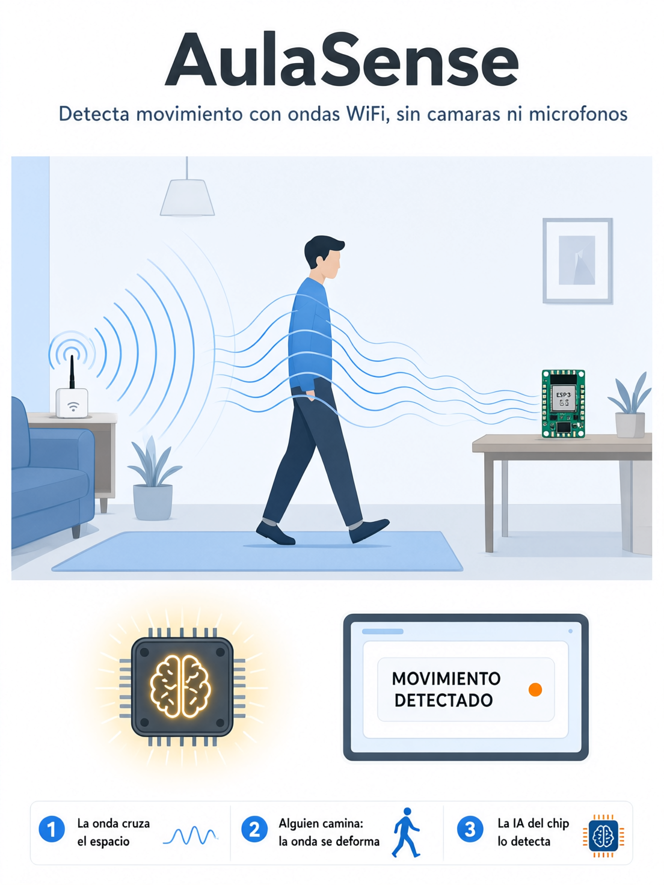{width=92%}
*Póster de funcionamiento (`poster_funcionamiento.png`, F25‑f2). Router emitiendo ondas, la persona
que las cruza, el chip que decide y el dashboard que lo muestra.*

---

## 2. El problema de las cámaras y la privacidad acotada

Una cámara de vigilancia en un aula graba **vídeo continuo de personas**: datos personales,
sin consentimiento y con riesgo de re‑identificación. AulaSense lo evita de raíz: la fuente de
verdad **no es la imagen, es el CSI**. La regla del proyecto es explícita — **"solo movimiento,
nunca vídeo continuo"**: la cámara OV3660 se dispara **solo 1 JPEG QVGA al onset de movimiento**,
con *cooldown* de 15 s, y nunca graba un flujo. La IA nunca hace reconocimiento facial: *"SIN
caras‑ML: no reintroducir detección facial"* (`AGENTS.md` regla 2). La privacidad se declara como
**acotada (local‑only), no "por construcción"**: *"C9 = cumple‑parcial (local‑only), no 'privacidad
por construcción'"* (`AGENTS.md`), y *"el CSI crudo nunca sale del chip"*.

Para ser honestos en clase, hay que nombrar también los **riesgos aceptados**. La publicación
pública del dashboard viaja por un túnel SSH cifrado en el tramo distro→VPS, pero **el último
tramo navegador→VPS es HTTP plano sin TLS**: *"un observador entre el cliente y el VPS ve el POST
`/login` (password) y puede reutilizar la cookie de sesión robada"* y *"las imágenes de evidencia
… se sirven en claro en ese tramo"* (`server/deploy/README_wsl.md`, nota formal de riesgo,
auditoría 2026‑11‑15). Mitigaciones propuestas y **pendientes**: cerrar el bind NAT del `:8100` a
`127.0.0.1` (**ACL/recomendada**), y el **TLS end‑to‑end queda "Pendiente humano"** fuera del
alcance actual. Además, la higiene obligatoria **rota la contraseña** con `tools/reset_admin.py`
tras cualquier uso real del login público (*"rota la password en `claves/.env`, nunca la
imprime"*).

{width=92%}
*Lámina 02 · la alternativa al CCTV: el Wi‑Fi percibe el movimiento sin grabar a nadie.*

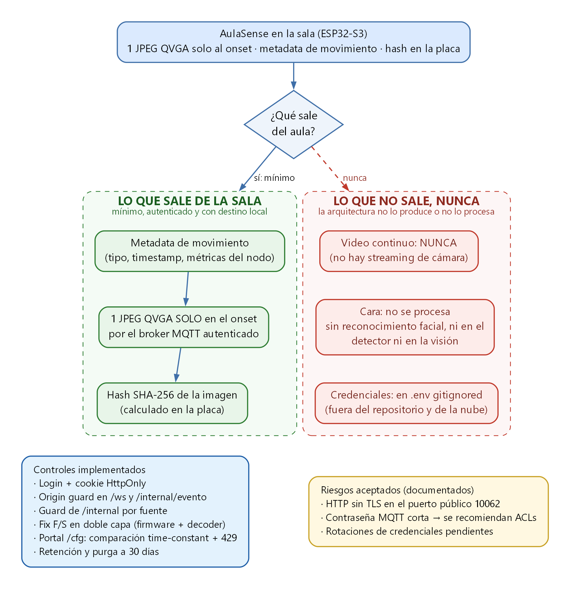{width=74%}
*Diagrama `privacidad_y_seguridad.png`. Columna "lo que sale de la sala" (metadatos de movimiento,
1 JPEG solo al onset por broker autenticado, hash SHA‑256) frente a "lo que no sale nunca" (vídeo
continuo, caras, credenciales).*

---

## 3. Cómo funciona: el CSI

El **principio físico** es sencillo de explicar y difícil de creer: una persona que se mueve
**perturba** las múltiples rutas (multipath) por las que la señal Wi‑Fi cruza la sala; esa
perturbación cambia la amplitud y la fase de las subportadoras. Esas variaciones se convierten en
un vector de características que alimenta a la red neuronal en‑chip. Ojo con el matiz honesto que
marca el propio diagrama: *"la persona **perturba** el canal (atenúa/desvía); el sistema no la
detecta, identifica ni cuenta"* — es decir, detecta **movimiento**, no presencia ni personas.

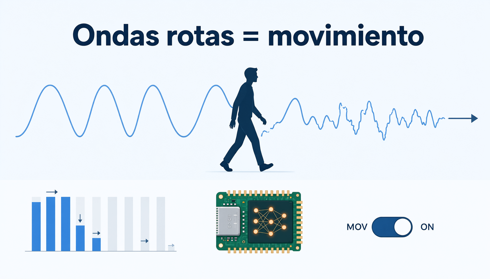{width=92%}
*Lámina 03 · la idea visual central: las ondas "rotas" (perturbadas) son el signo del movimiento.*

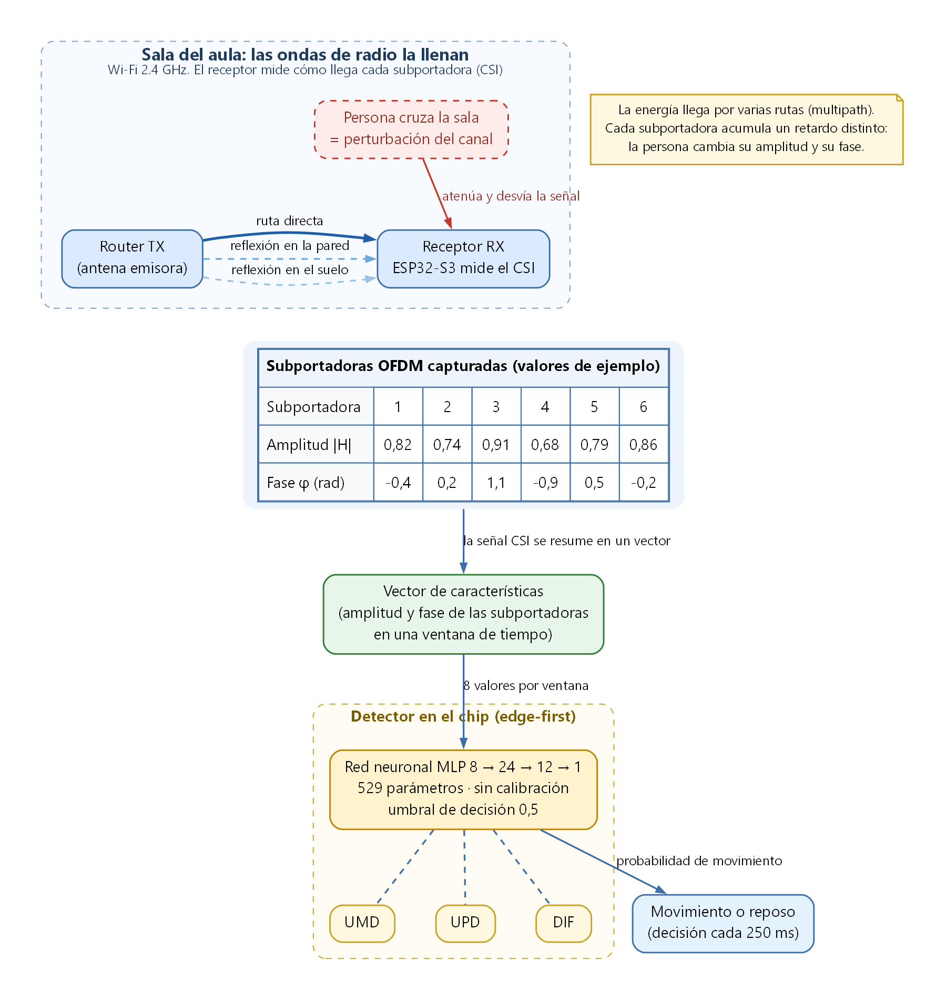{width=70%}
*Diagrama `principio_csi.png`: router → ondas multipath → perturbación por la persona → bloques de
subportadoras → vector → detector MLP 8→24→12→1 (529 parámetros) → decisión cada 250 ms. (Los
valores de amplitud/fase de la tabla son **ilustrativos**, no una captura medida.)*

Cuando el detector decide *motion*, ocurre una **secuencia de evidencia** con latencias reales
medidas: la cámara captura el JPEG, se hashea (SHA‑256) y se codifica **en la placa**, viaja por la
**misma conexión MQTT persistente** del nodo (norma N1) al broker, el decoder valida y deduplica, y
la fila entra en la BD con `canal='mqtt'` (con fallback HTTP `:8001`, norma N2). Las latencias son
de documento, no de promesa: *"14–361 ms en firmware; ~1 s broker→fila en BD"*
(`assets/diagramas_explicativos/README.md`, figura 1), coincidiendo con el guion del video:
*"F3 latencia real medida 14–361 ms"*.

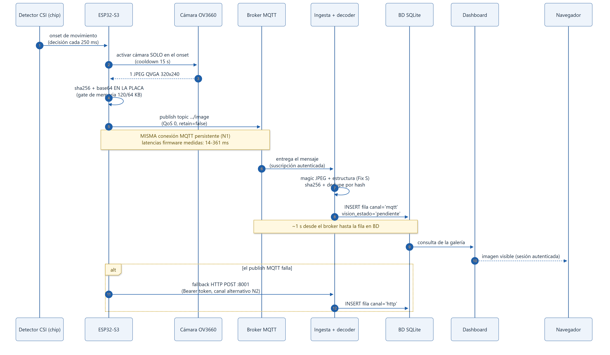{width=94%}
*Diagrama `secuencia_foto_evidencia.png`: la foto se activa **solo** en el onset y se transporta por
la misma conexión MQTT. Rama `alt` = fallback HTTP :8001. Latencias anotadas (14–361 ms firmware;
~1 s broker→fila).*

---

## 4. Dónde corre cada cosa

El sistema reparte el trabajo en **cuatro capas físicas**. El **nodo ESP32‑S3** hace todo el
sensing y la inferencia (edge‑first: *"Ningún procesamiento de sensing/IA se mueve al PC"*,
`AGENTS.md` regla 1). El **router de casa** es a la vez la fuente de estímulo CSI y la puerta de
salida del nodo al **broker `broker.gilman.pro:14769`** (en el VPS 167.114.169.134). El **PC con
WSL Debian**, en la distro dedicada **`debian-aulasense`**, corre la ingesta, la base SQLite y el
dashboard interno **`:8100`**, que se publica al mundo por un **túnel SSH** hacia el puerto público
**`:10062`**. Hay **dos fronteras de confianza**: la LAN local e Internet.

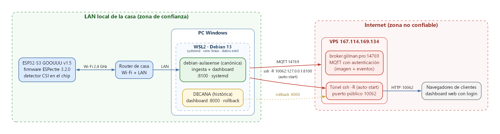{width=100%}
*Diagrama `topologia_despliegue.png`: cadena ESP32‑S3 → router → WSL2 `debian-aulasense` (`:8100`;
la `:8000` clásica como rollback) → broker (VPS) → túnel `ssh -R` auto‑start → `:10062` público.
Cajas punteadas = frontera LAN / frontera Internet.*

Y así fluyen los **datos**, del sensor al informe: CSI ~100 pps → características → detector
(umbral 0,5) → eventos motion/onset → ingesta (fotos, telemetría) → **BD SQLite WAL con writer
único** → dashboard (login, búsqueda) → **visión modo B** (con techos 120/día y 20/hora) →
análisis `run_analisis.ps1` → `analisis.json` → informes `generar_informe.py` (docx/pptx). Todo el
pipeline es reproducible con **un comando por entrega**.

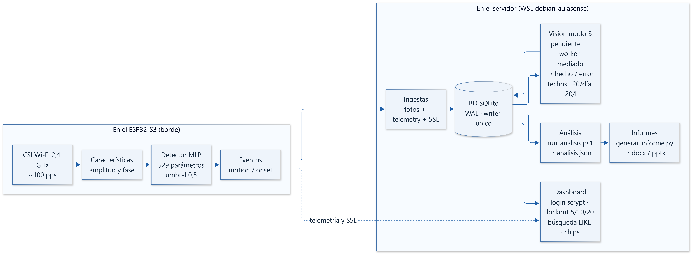{width=100%}
*Diagrama `pipeline_datos.png`: el recorrido completo desde la señal cruda en la placa hasta el
informe, marcado con los techos de presupuesto de visión (120/día, 20/hora).*

---

## 5. La evidencia fotográfica y su honestidad

Sobre las fotos de evidencia hay que contar **la verdad incómoda**, no solo la idea bonita. Hay
**54 fotos reales** en la BD (el `analisis.json` lo registra como *"Fotos reales (post‑exclusion):
54"* tras excluir 1 *fire‑test*). Al validarlas con Pillow estricto, la **integridad JPEG es del
57,4 %**: *"Validas: 31 · Rotas: 23 … **Tasa de integridad: 0.5741**"* (`informe_metricas.md`).
La causa raíz está documentada: un **byte‑loss de 16 B por overflow GDMA** en la captura —
OV3660→PSRAM octal bajo la carga combinada de CSI + Wi‑Fi (`SPEC.md`;
`iot2/.tmp/jpegqc_causa_raiz.md`). Ese fallo se dio **antes** del arreglo, así que un subconjunto
de las fotos **es irrecoverable de origen**: en el estado final de la visión, *"**20** [fotos]
irreparables de origen (corrupción en captura pre‑Fix F)"* quedan en `'error'`.

La respuesta ingenieril fue una **doble capa**, y es honesta porque separa lo que se arregla de lo
que no se puede arreglar. **Fix F** (en placa): baja el reloj de la cámara `xclk_freq_hz` de
20→**10 MHz** y añade `jpeg_sintaxis_ok()` **antes de hashear/publicar**, de modo que *"frame malo
→ NO sube"* (`SPEC.md`). **Fix S** (en el decoder y en el worker): descarte estructural
*`_jpeg_estructura_ok`* y una **validación local de dos etapas** que, antes de gastar Credits,
rechaza lo ilegible *"sin coste de Credits"*. Criterio post‑flash declarado: *"0 fotos rotas
nuevas persistidas"*.

{width=92%}
*Lámina 04 · la foto es evidencia accesoria de un evento, no vigilancia: se dispara solo con el
movimiento, viaja por MQTT y nunca sustituye al detector CSI.*

---

## 6. Qué dice la IA

Una capa opcional de **visión con IA** describe las fotos de evidencia para poder buscarlas por
texto en la galería. Usa un modelo de lenguaje multimodal de Qwen en **modo B "agente‑mediado"**
(el humano/orquestador lanza cada pasada), porque los **Términos de Servicio del Token Plan**
prohíben usar la clave `sk-sp-` en un daemon autónomo: *"la key `sk-sp-` es SOLO para uso
interactivo en agentes — PROHIBIDO daemon autónomo con ella"* (`AGENTS.md` regla 13). Cada pasada
está **topada por presupuesto**: techos de **120 llamadas/día y 20/hora** con deduplicación por
hash, *backoff* ante 429 y contador persistente (`informe_metricas.md`: *"topes 120/dia 20/h"*).

Sobre las **descripciones concretas** de las imágenes, la guía es honesta con lo que hay en disco:
el `informe_metricas.md` **no incluye el texto libre de cada descripción** (esas cadenas viven
únicamente en la columna `descripcion` de la base SQLite de WSL, consultable solo‑lectura). Lo que
**sí** reporta el informe es el **balance de la pasada de visión**, que es la cifra citable:
*`Estados imagenes reales: {"error": 20, "hecho": 34, "omitido": 1}`*; es decir, **34 hechas · 20
error · 1 omitido** (`README.md`: *"visión modo B **cerrada** 34 hechas/20 error
irreparables/1 omitido"*). El consumo total medido fue **18 895 tokens** (media real **484,5
tok/imagen**). Los **20 `error`** son precisamente las fotos irreparables del punto 5, saltadas por
el QC local **sin gastar Credits**; el **1 `omitido`** es el artefacto del *fire‑test* (id 56) que
no debía consumirse. *(Nota de esta guía: no se muestran descripciones individuales porque no
están en los documentos citados; exponerlas obliga a leer la BD, y ahí sí son datos del aula.)*

---

## 7. Qué dicen los datos

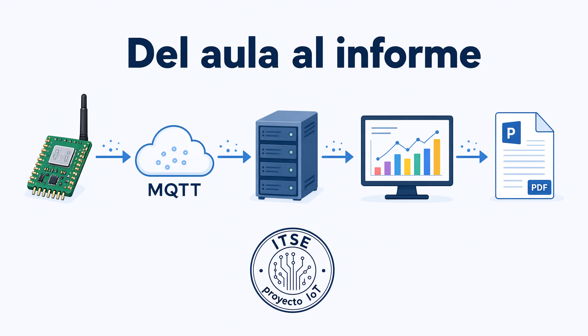{width=92%}
*Lámina 05 · el cierre del arco: del movimiento capturado en el aula al informe final del proyecto.*

El dataset propio real se resume en `docs/analisis/analisis.json`, generado de forma determinista
por `run_analisis.ps1`. Sobre las **187 evaluaciones/eventos reales** del rango analizado, la
sesión activa **F4S1B** registró un **6,13 % de tiempo en motion** (`informe_metricas.md`:
`%motion = 6.1311`, con score de movimiento mediano **0.9993**); la sesión base **F4S1** quedó en
**0,0 %**. Los scores de confianza de los onsets son muy altos (mediana **0.9997**, media **0.96**)
— señal de que el detector dispara con seguridad cuando hay movimiento.

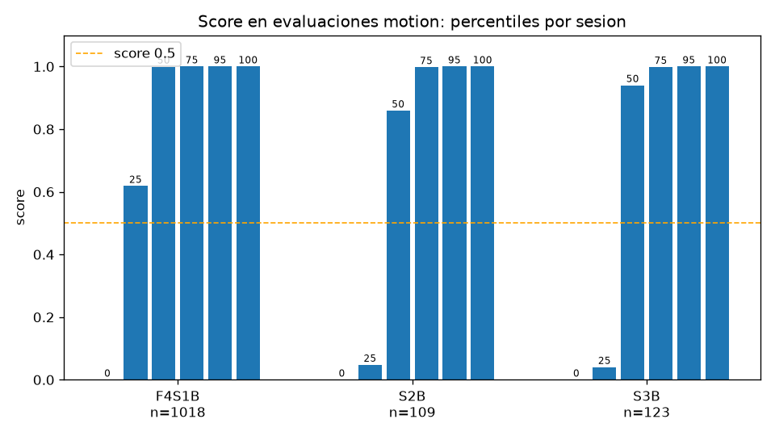{width=80%}
*`histograma_scores.png` (F5a): distribución de los scores del detector. La masa se concentra en
valores altos, de ahí las medianas cercanas a 1.*

Contra la **verdad terreno** (*ground truth*) la métrica clave es el **recall de movimiento = 87,9 %**
(*"TP=29 FN=4 **recall motion = 0.8788**"*). Y aquí va la **nota de honestidad obligatoria**, citada
tal cual: *"RECALL‑ONLY: el GT actual es `pasivo_foto_corroborada` (solo motion confirmado por
foto; los huecos quedan sin‑dato, **NO** son idle). FPR/precision no computables. Al existir
marcas idle de las sesiones activas S2/S3 el mismo codigo produce FPR/TPR/precision reales sin
cambio de codigo."* La **integridad de las imágenes** vuelve a salir, ahora como cifra del
pipeline: **57,4 %**, con la misma nota pre‑Fix F del punto 5. El modelo predictivo de ocupación
por franja horaria se valida contra el terreno en la siguiente figura, y las **sesiones S2 y S3 se
grabarán mañana**, cuando entren los tramos `idle` y se puedan calcular FPR y precisión reales.

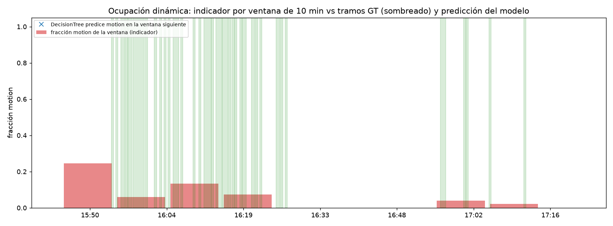{width=84%}
*`ocupacion_modelo_vs_gt.png` (F5a): la predicción de actividad por hora frente a la verdad terreno
(solo‑lectura sobre el dataset real).*

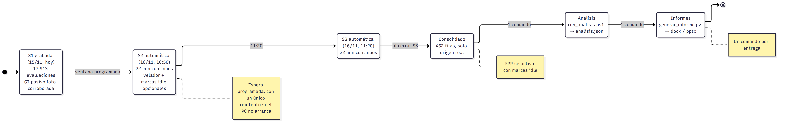{width=100%}
*Diagrama `ciclo_de_vida_sesiones.png`: S1 grabada hoy (GT pasivo foto‑corroborado) → S2 y S3
programadas (aportan marcas `idle` y activan FPR) → consolidado de 462 filas → análisis y
regeneración de informes.*

---

## 8. Los videos

Hay **dos videos** listos en `docs/` y verificados con `ffprobe` en esta sesión de entrega:

- **`docs/video_aulasense.mp4` — 65,96 s (~66 s), H.264 + AAC (con narración en español).** Es el
  **arco completo**: arranca en el problema original (somnolencia al volante / DriveGuard), explica
  el fallo de la cámara, presenta la idea del Wi‑Fi como sensor, la IA en el chip (529 parámetros,
  250 ms), el pipeline, la evidencia con login, los datos y el cierre con la finalidad del proyecto.
  El `docs/README.md` lo confirma: *"Video explicativo completo (H.264+AAC 480P, 65,96 s verificado
  por ffprobe 2026‑11‑15)"*.
- **`docs/video_como_funciona_40s.mp4` — 40,00 s, H.264 sin pista de audio (verificado: solo
  stream de vídeo).** Es el resumen **silencioso** para proyectar en clase sin sonido ambiente.

Su **honestidad** está declarada en el guion: el video *"dice 'detecta movimiento', nunca
'presencia'"*, *"no cita métricas del vendor"* y avisa de que una miniatura de la escena 6 muestra
*"un rostro sintético generado por la IA (no es persona real)"* (`docs/README.md`, nota QC del
video). **Cómo verlos**: son archivos del repo en la ruta `aulasense/docs/` (ábrelas con cualquier
reproductor); y el sistema real detrás se ve en vivo en el **dashboard público `:10062`** (sección
9).

---

## 9. El sistema en vivo

El dashboard en producción es la **vía pública primaria**: `http://167.114.169.134:10062`, que es
la publicación en el VPS del dashboard interno `:8100` de la distro `debian-aulasense` vía túnel SSH
auto‑start (sin admin de Windows). Verificado desde fuera el 2026‑11‑15: `/login` → **200** y
`/api/eventos` → **401** sin cookie (`docs/README.md`). **Requiere login**: usuario `admin`, y la
contraseña **la genera el código** (`secrets.token_hex(16)`) y vive en **`claves/.env`** (carpeta
gitignored) — *"NUNCA se imprime en documentación"* — así que esta guía, deliberadamente, **no
contiene ninguna contraseña**.

- **Acceso**: entra por `/login`, inicia sesión con el usuario `admin` y la password de
  `claves/.env` (canal local, nunca impresa).
- **Portal de configuración del firmware (`/cfg`)**: si el nodo pierde la red, levanta un **AP
  fallback** `AULASENSE-CFG-<4 hex>` y sirve un portal privado en `http://192.168.4.1/cfg/<token>`
  (el token va por consola serial, 404 sin él, nunca loguea SSID/clave). Según `docs/README.md`,
  los **criterios E2–E5 del portal quedan "pendiente‑ventana‑natural"** (se ejercitarán con la
  primera caída real del router o en la demo).
- **Reset de acceso**: `tools/reset_admin.py` **regenera** la password en `claves/.env` y nunca la
  imprime — es la higiene obligatoria mientras `:10062` esté en HTTP (sección 2).

> Recordatorio honesto de seguridad: el último tramo navegador→VPS es **HTTP sin TLS** (riesgo
> aceptado y documentado); el login, el Origin guard y las cabeceras mitig a nivel de aplicación,
> pero **no cifran la red** (`server/deploy/README_wsl.md`).

---

## 10. Cómo reproducir y continuar

Comandos **canónicos** (verificados contra los scripts reales en `tools/` y `analysis/`; usa
`C:\Python315\python.exe` o el venv del server porque el `python` del PATH está roto — `AGENTS.md`
regla 3):

```powershell
# 1) Analisis completo determinista (EDA + modelo + figuras -> docs/analisis/).
powershell analysis\run_analisis.ps1            # variante smoke offline: -SinWsl ; solo metricas: -NoFiguras

# 2) Regenerar el informe Word y la presentacion PPTX desde los JSON del analisis.
server\.venv\Scripts\python.exe tools\generar_informe.py

# 3) Pasada de vision modo B (una sola pasada a la vez, dentro del turno del agente).
#    AGENTS.md regla 16: NUNCA dejar vision_describe en background entre turnos.
server\.venv\Scripts\python.exe tools\vision_describe.py --once --limit 30

# 4) Estado del runtime WSL (ingesta + dashboard + vision; URL publica del dashboard).
powershell tools\wsl_aulasense.ps1 status

# 5) Reset de la password admin (la regenera el codigo en claves/.env; nunca la imprime).
server\.venv\Scripts\python.exe tools\reset_admin.py
```

**Dónde está todo** (tabla de entregables, rutas del repo; las figuras de esta guía son subconjunto):

| Entregable | Ruta | Qué contiene |
|---|---|---|
| **Guía visual maestra** | `docs/GUIA_VISUAL.md` · `.docx` · `.pdf` (`docs/entrega/`) | Este documento |
| Serie de láminas (5) | `assets/lamina_series/lamina_01..05_*.png` | Portada, cámaras, CSI, evidencia, resultados |
| Póster de funcionamiento | `assets/poster_funcionamiento.png` | Concepto CSI en una lámina |
| Diagramas explicativos (6) | `assets/diagramas_explicativos/*.png` | CSI, foto‑evidencia, topología, pipeline, privacidad, ciclo de sesiones |
| Gráficos del análisis (F5a) | `docs/analisis/graficos/*.png` | Histograma, modelo vs GT, serie motion, matriz de confusión… |
| Métricas del pipeline | `docs/analisis/analisis.json` · `informe_metricas.md` | Cifras citables (recall, integridad, visión, latencias) |
| Videos | `docs/video_aulasense.mp4` (66 s) · `docs/video_como_funciona_40s.mp4` (40 s) | Explicativo con audio y resumen silencioso |
| Informe / presentación | `docs/entrega/INFORME.docx` · `PRESENTACION.pptx` · `PRESENTACION_VISUAL.pptx` | Generados con `generar_informe.py` |
| Dataset real publicado | `dataset/sesion_1/*.jsonl` · `analysis/dataset/consolidado.csv` | 462 filas `origen=real` (S2/S3 mañana) |
| Firmware / server / tools | `firmware/` · `server/` · `tools/` | Código reproducible (GPLv3 el derivado del vendor) |

**Para continuar**: grabadas las sesiones **S2/S3**, basta con volver a lanzar
`run_analisis.ps1` y `generar_informe.py`; el pipeline *"los descubre por glob, cero cambios"* y
el mismo código produce **FPR y precisión reales** cuando existan marcas `idle`
(`informe_metricas.md`). El checklist vivo (`iot2/.tmp/checklist.md`, v25) es la fuente de verdad
renglón a renglón del estado del proyecto.

---

*Documento generado el 2026‑11‑15 para la exposición del proyecto AulaSense (ITSE — Big Data e
IA). Todas las cifras provienen de los archivos citados; no se introdujeron números nuevos.*
